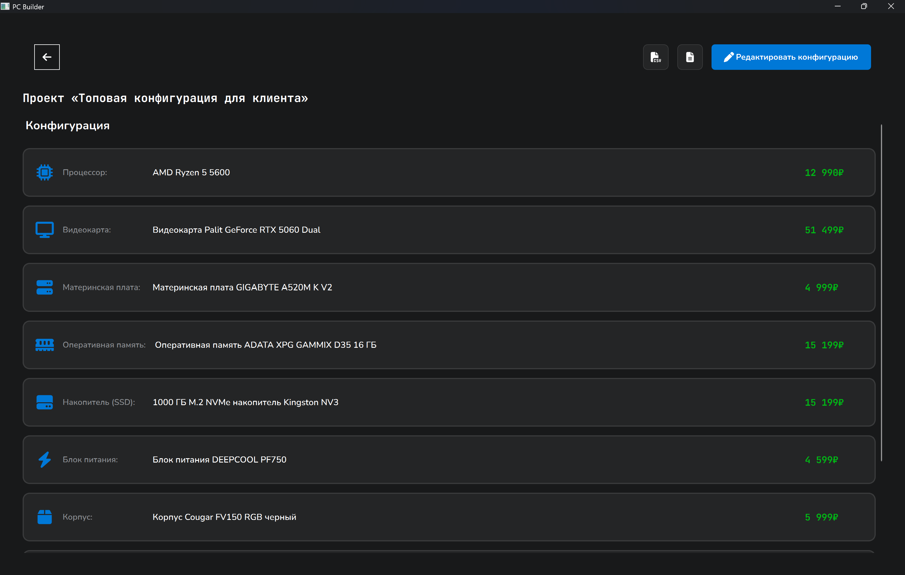
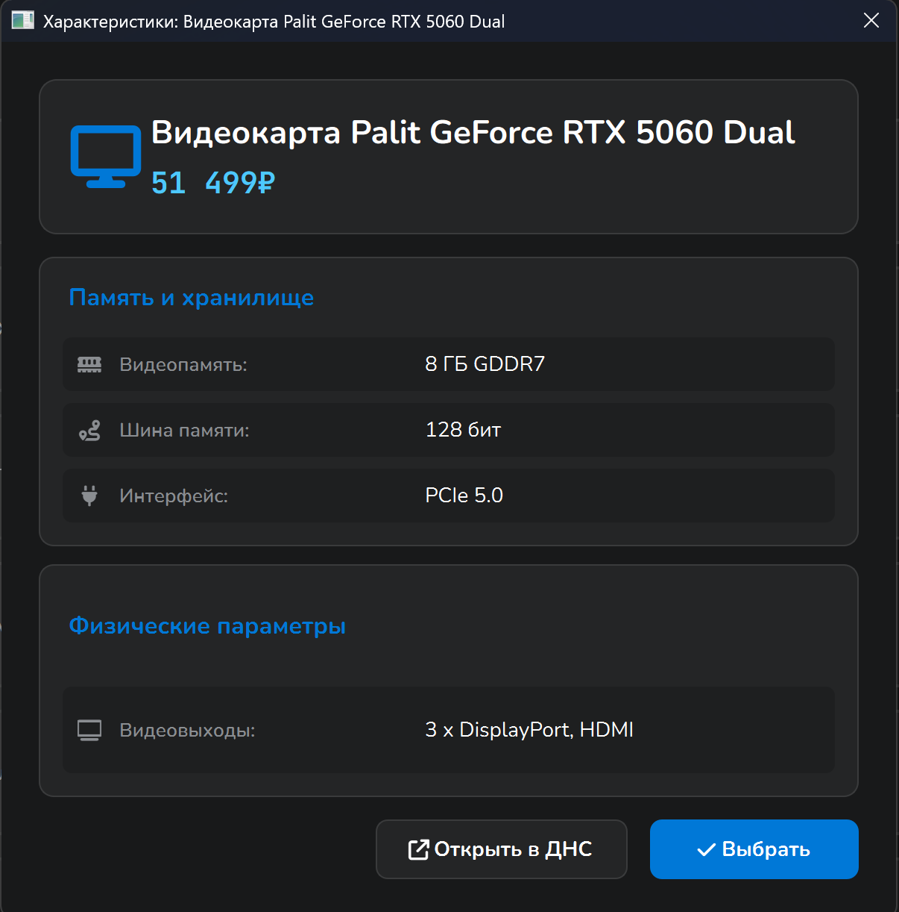

# 🖥️ Конфигуратор сборок PC Builder


[Русский](#-о-проекте) | [English](#️-assembly-configurator-pcbuilder)


## 📌 Навигация по README.md:

- 📖 [О проекте](#-о-проекте)
- ✨ [Возможности](#-возможности)
- 📸 [Скриншоты](#-скриншоты)
- 🛠️ [Стек технологий](#️-стек-технологий)
- 🚀 [Установка и запуск](#-установка-и-запуск)

## 📖 О проекте

**PCBuilder** - Современное кроссплатформенное десктопное приложение для просмотра, управления и экспорта конфигураций сборок ПК. Разработано на **Python** с использованием фреймворка **PyQt6**.

Приложение отличается чистым кодом, модульной архитектурой, тёмной темой оформления и удобными горячими клавишами.

---

## ✨ Возможности

### Ключевые возможности PCBuilder:

- 📊 **Дашборд** со статистикой, быстрым доступом и ссылками на магазины
- 📁 **Каталог проектов** с поиском, сортировкой и двумя режимами отображения
- ⚙️ **Конфигуратор** с 8 категориями комплектующих и поиском
- 🔍 **Проверка совместимости** в реальном времени (сокеты, память, БП, корпус)
- ✏️ **Inline-редактирование** названия и удаление проекта
- 📤 **Экспорт** конфигурации в CSV и TXT
- ⌨️ **Горячие клавиши** для быстрого сохранения и навигации
- 🎨 **Современный UI**: тёмная тема, кастомные шрифты, адаптивная сетка

---

## 📸 Скриншоты

| Дашборд | Конфигуратор | Страница проекта |
|---------|--------------|------------------|
|  |  |  |

| Характеристики комплектующих | Все проекты |
| ----------------- | ----------------- |
|  |  |


---

## 🛠️ Стек технологий

- **Язык**: Python 3.10+
- **GUI**: PyQt6
- **Иконки**: QtAwesome
- **Хранение данных**:
   - **О проектах пользователей** - в JSON, который создается для каждого пользователя лично
   - **Все комплектующие** - в БД SQLite локально в папке приложения
- **Линтеры**: black и flake8

### Технологии и виджеты из PyQt6

| Виджет | Применение в проекте |
|:---|:---|
| `QMainWindow` | Главное окно приложения |
| `QWidget` | Базовый контейнер для страниц и кастомных виджетов |
| `QFrame` | Основа для стилизованных карточек (проектов, компонентов, статистики) |
| `QLabel` | Отображение текста, иконок и градиентного логотипа |
| `QPushButton` | Кнопки действий, переключатели вида, экспорт |
| `QLineEdit` | Поля поиска с иконкой и ввода данных в формах |
| `QTextEdit` | Многострочное поле для описания проекта |
| `QComboBox` | Выпадающий список для сортировки проектов |
| `QScrollArea` | Прокрутка списков проектов и длинных страниц |
| `QTabWidget` | Вкладки в конфигураторе комплектующих |
| `QListWidget` / `QListWidgetItem` | Списки компонентов с кастомными виджетами внутри |
| `QSplitter` | Разделитель колонок на дашборде |
| `QStackedWidget` | Переключение между страницами (дашборд, каталог, проект) |
| `QDialog` | Модальные окна (конфигуратор, детали компонента) |
| `QMessageBox` | Уведомления, предупреждения и подтверждения действий |
| `QFileDialog` | Нативное окно выбора пути для экспорта CSV/TXT |

---

## 🚀 Установка и запуск

1. **Склонируйте репозиторий**:
   ```bash
   git clone https://github.com/tylerderden9681-wq/PcBuilder.git
   cd PcBuilder

2. **Создайте виртуальное окружение**:

   *Примечание*: на разных OC команды немного отличаются, так что используйте команды, применимые именно для вашей OC и вашего терминала:

   **Linux/MacOS**:
   ```bash
   source venv/bin/activate
   ```

   **Windows**:

   В Windows не так всё просто, так как для разных терминалов команды немного отличаются и выглядят следующим образом:

   **CMD**:
   ```bash
   venv\Scripts\activate
   ```

   **PowerShell**:
   ```bash
   venv\Scripts\Activate.ps1
   ```

   **Git Bash / MINGW**:
   ```bash
   source venv/Scripts/activate
   ```

3. **Установите зависимости**:

   - В режиме разработки предпочтительно установить зависимости из `requirements/dev.txt`, где находятся линтеры для грамотного и понятного написания кода:

   ```bash
   pip install -r requirements/dev.txt
   ```

   - Для работы проекта нужно установить зависимости, находящиеся в файле `requirements/prod.txt`, так что воспользуйтесь командой:

   ```bash
   pip install -r requirements/prod.txt
   ```

4. **Запустите проект**:

   Чтобы запустить проект, воспользуйтесь командой:
   ```bash
   python main.py
   ```


## 🖥️ Assembly Configurator PcBuilder

## 📌 Navigation of README.md:

- 📖 [About Project](#-about-project)
- ✨ [Features](#-features)
- 📸 [Screenshots](#-screenshots)
- 🛠️ [Technologies stack](#️-used-technologies)
- 🚀 [Installation and launching](#-installing-and-launch-project)

## 📖 About Project

**PCBuilder** - A modern cross‑platform desktop application for viewing, managing, and exporting PC build configurations. Developed in **Python** using the **PyQt6** framework.

The application is characterized by clean code (the code was written using the `flake8` and `black` linters), a modular architecture, a dark theme, and convenient hotkeys.

---

## ✨ Features

### Main Features of PCBuilder:

- 📊 **Dashboard** with statistics, quick access, and links to stores
- 📁 **Projects List** with search, sorting, and two display modes
- ⚙️ **Configurator** with 8 categories of components and search
- 🔍 **Real-time compatibility check** (sockets, memory, power supply, case)
- ✏️ **Inline editing** of the project name and deletion of the project
- 📤 **Export** of configurations to CSV and TXT
- ⌨️ **HotKeys** for quick saving and navigation
- 🎨 **Modern UI**: dark theme, custom fonts, adaptive grid

---

## 📸 Screenshots

| Dashboard | Configurator | Project Page |
|---------|--------------|------------------|
|  |  |  |

| Component specifications | All Projects |
| ----------------- | ----------------- |
|  |  |

---

## 🛠️ Used technologies

- **Programming Language**: Python 3.10+
- **GUI**: PyQt6
- **Icons**: QtAwesome
- **Data Storage**:
   - **About Users Projects** - in the JSON that is created locally for each user
   - **All Dependencies** - in the database locally in the application folder
- **Linters**: black and flake8

### Technologies and widgets from PyQt6

| Widget | Usage in the project |
|:---|:---|
| `QMainWindow` | Main application window |
| `QWidget` | Base container for pages and custom widgets |
| `QFrame` | Base for styled cards (projects, components, statistics) |
| `QLabel` | Displaying text, icons, and gradient logo |
| `QPushButton` | Action buttons, view toggles, export |
| `QLineEdit` | Search fields with icon and form data input |
| `QTextEdit` | Multi-line field for project description |
| `QComboBox` | Dropdown list for project sorting |
| `QScrollArea` | Scrolling for project lists and long pages |
| `QTabWidget` | Tabs in the component configurator |
| `QListWidget` / `QListWidgetItem` | Component lists with custom widgets inside |
| `QSplitter` | Column divider on the dashboard |
| `QStackedWidget` | Switching between pages (dashboard, catalog, project) |
| `QDialog` | Modal windows (configurator, component details) |
| `QMessageBox` | Notifications, warnings, and action confirmations |
| `QFileDialog` | Native path selection dialog for CSV/TXT export |

---

## 🚀 Installing and launch project

1. **Clone the repository**:
   ```bash
   git clone https://github.com/tylerderden9681-wq/PcBuilder.git
   cd PcBuilder

2. **Create a virtual environment**:

   *Note*: the commands differ slightly across different operating systems, so use the commands that are applicable to your specific operating system and terminal:

   **Linux/MacOS**:
   ```bash
   source venv/bin/activate
   ```

   **Windows**:

   In Windows, things aren’t that simple, as the commands differ slightly for different terminals and look like this:

   **CMD**:
   ```bash
   venv\Scripts\activate
   ```

   **PowerShell**:
   ```bash
   venv\Scripts\Activate.ps1
   ```

   **Git Bash / MINGW**:
   ```bash
   source venv/Scripts/activate
   ```

3. **Install the dependencies**:

   - In development mode, it is preferable to install dependencies from `requirements/dev.txt`, which contains linters that help ensure code is written in a proper and readable manner:

   ```bash
   pip install -r requirements/dev.txt
   ```

   - To run the project, you need to install the dependencies listed in the `requirements/prod.txt` file, so use the following command:

   ```bash
   pip install -r requirements.txt
   ```

4. **Launch the project**:

   To launch the project, use the command:
   ```bash
   python main.py
   ```

